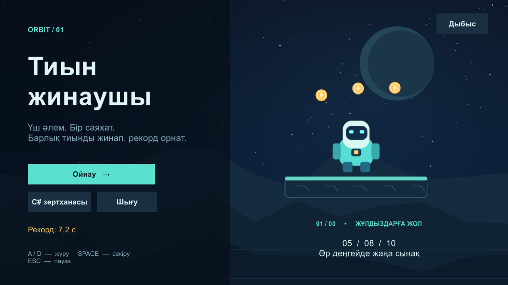
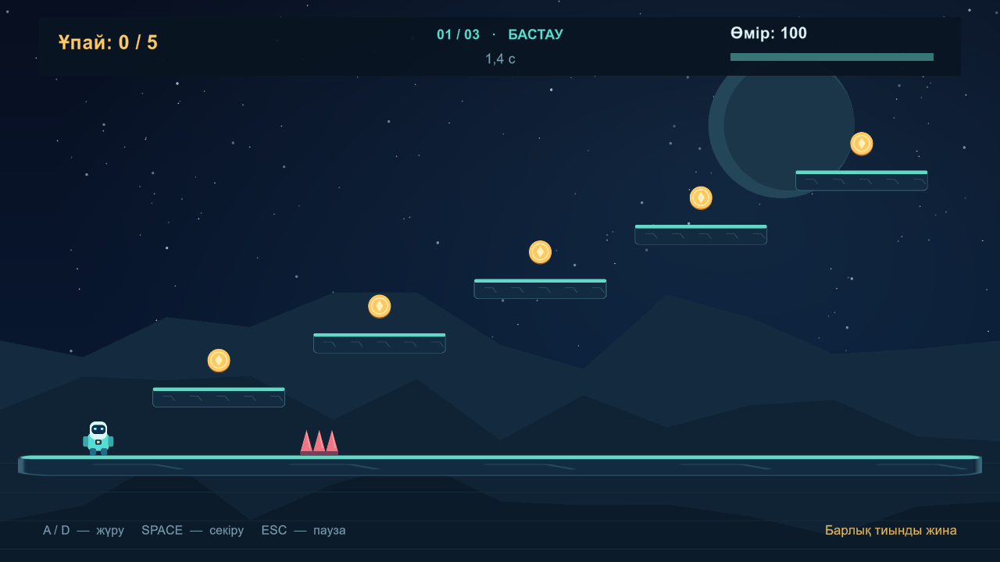
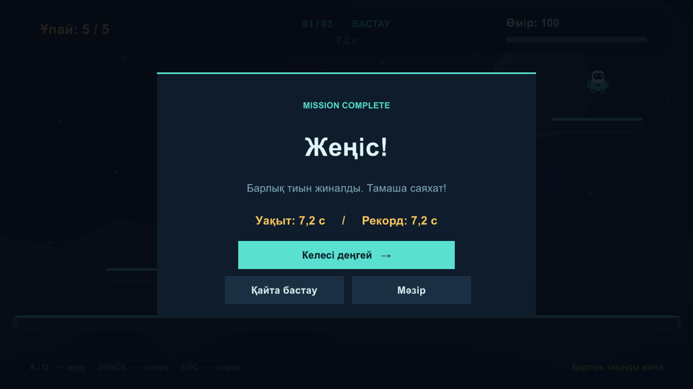

# CoinCollector777 — Тиын жинаушы

Unity 6.0.83f1 · 2D platformer · Modules 2–5

## Запуск

Готовая игра: соседняя папка `Windows`, файл `CoinCollector.exe`.
Переносите всю папку Windows: исполняемому файлу нужны Data, UnityPlayer.dll и другие файлы сборки.

Исходники: Unity Hub → Add project from disk → выбрать эту папку → открыть сцену
`Assets/Scenes/MainMenu.unity` → Play.

## Управление

- A/D или стрелки: движение.
- Пробел: прыжок с поверхности.
- Esc: пауза / продолжение.
- Дыбыс: включение / отключение звука в главном меню.
- В C#-лаборатории 1/2/3 меняют скорость на 2/5/10; пробел выводит «Секіру!» в Console.

## Сцены и задания

| Сцена / файл | Что реализовано |
|---|---|
| MainMenu | Старт, выход, рекорд первого уровня, лаборатория, звук |
| Game | 5 монет, движение и прыжки, Rigidbody2D, Ground/Coin/Enemy |
| Level2 | 8 монет, 3 группы шипов, платформы, переход на третий уровень |
| Level3 | 10 монет, 5 групп шипов, более высокие платформы, финальная победа |
| Module2 | Цикл вперёд и назад, массив из 5 имён, AddScore до 135, жизнь 70/20/-20, Mover |
| Player.cs | Счёт, урон по 20, Slider, мигание 0.2 с, звук, победа, PlayerPrefs |
| PauseManager.cs | Пауза без начисления времени, запрет паузы поверх завершённой игры |
| CoinPulse.anim | Зацикленные ключи масштаба 1 → 1.3 → 1 за секунду |
| Coin.prefab / Spawner.cs | Префаб и дополнительный пример генерации монет циклом |

Имена в Task2 — примеры, поскольку список одногруппников не предоставлен.
HealthLesson отдельно сохраняет отрицательное здоровье из упражнения; в игре здоровье ограничено нулём.
Для предотвращения мгновенного поражения при касании шипов действует интервал урона 0.85 с.

## Рекорды

Ключи PlayerPrefs: `BestTime_Game`, `BestTime_Level2`, `BestTime_Level3`.
Меньшее время заменяет старый рекорд. Пауза не включается во время прохождения.
Сохранение вызывается сразу после победы; данные остаются после закрытия игры.

## Редактирование и сборка

Все сцены содержат обычные редактируемые объекты, компоненты и назначенные ссылки.
Порядок Build Profiles: MainMenu, Game, Level2, Level3, Module2.

Меню `Coin Collector / Validate scenes` проверяет число монет, ссылки и финальную кнопку.
`Coin Collector / Rebuild scenes and Windows game` пересоздаёт авторские сцены и собирает Windows-версию.
Не используйте пересоздание после ручного редактирования уровней без резервной копии.
Для обычной повторной сборки используйте File → Build Profiles.

## Проверка

`GameVerification.cs` — отключённый по умолчанию интеграционный сценарий.
Он включается только одноразовым файлом `QA_REQUEST` рядом с exe.
Проверяет маршруты по платформам через физику, столкновения, переходы, паузу,
состояния UI и записи рекордов. Дополнительные монеты проверяет позиционированием
персонажа в триггер, что отдельно отмечено в отчёте. Тестовые рекорды затем убираются.

## Материалы

Графика персонажа, монет, платформ, шипов, фон и синтезированные звуки созданы для этого проекта.
Unity UI / TextMeshPro включён как embedded package; лицензия находится внутри пакета.
Arial взят из установленной Windows для отображения казахских букв.

## GitHub

Репозиторий: https://github.com/coolsanzhar667/CoinCollector777

Unity .gitignore исключает Library, Temp, Logs и локальные сборки.
Скриншоты и отчёт интеграционной проверки находятся в `Documentation`.

Справка по используемым Unity API:
- https://docs.unity3d.com/6000.0/ScriptReference/Rigidbody2D-linearVelocity.html
- https://docs.unity3d.com/6000.0/ScriptReference/BuildPipeline.BuildPlayer.html
